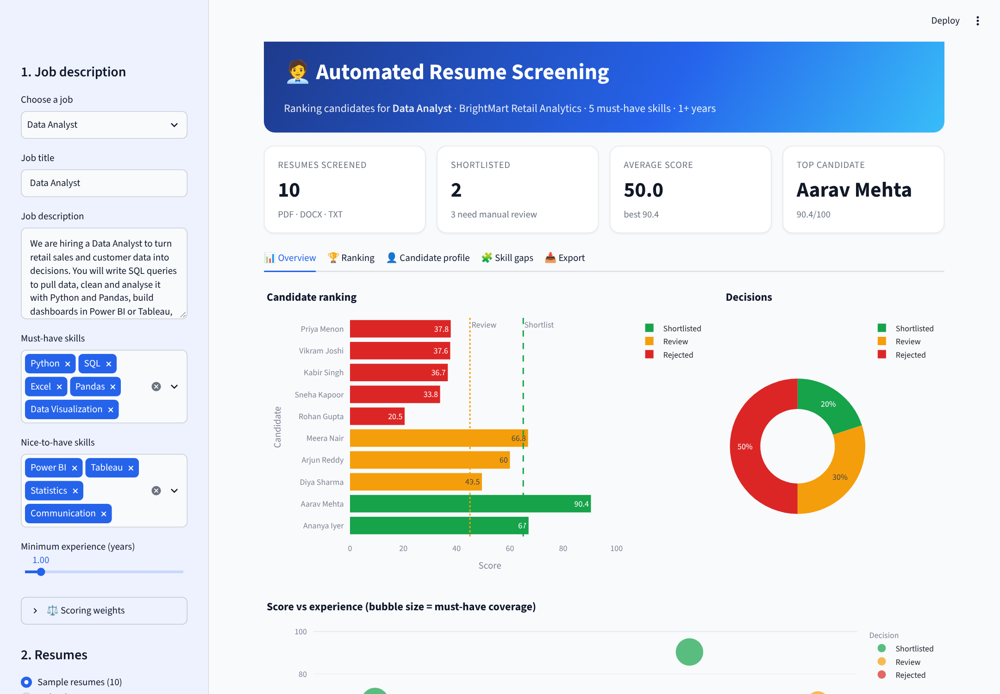
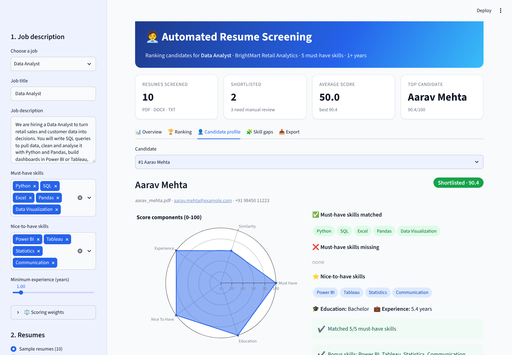
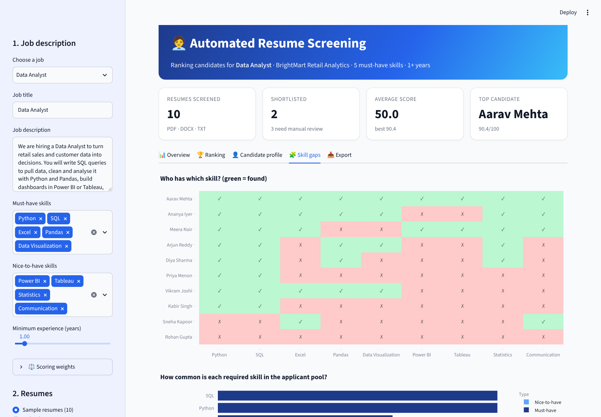
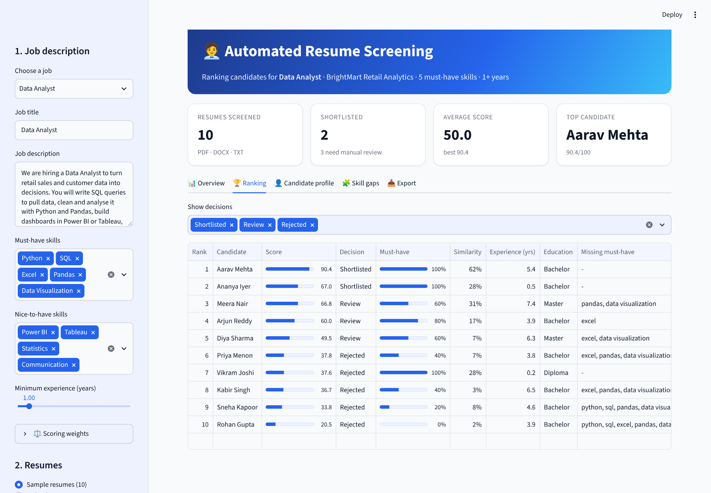
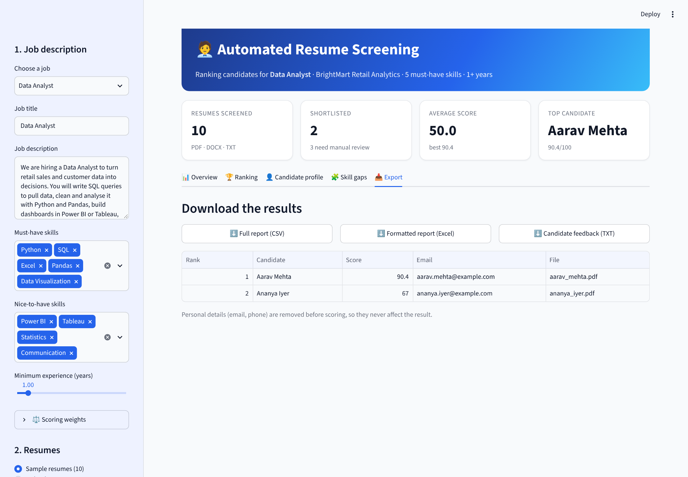
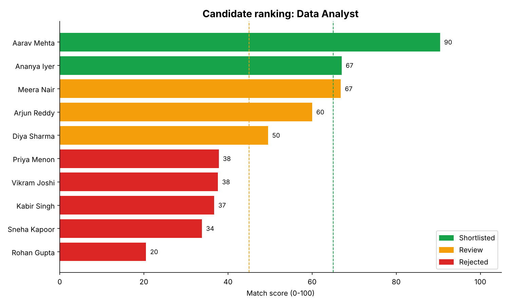
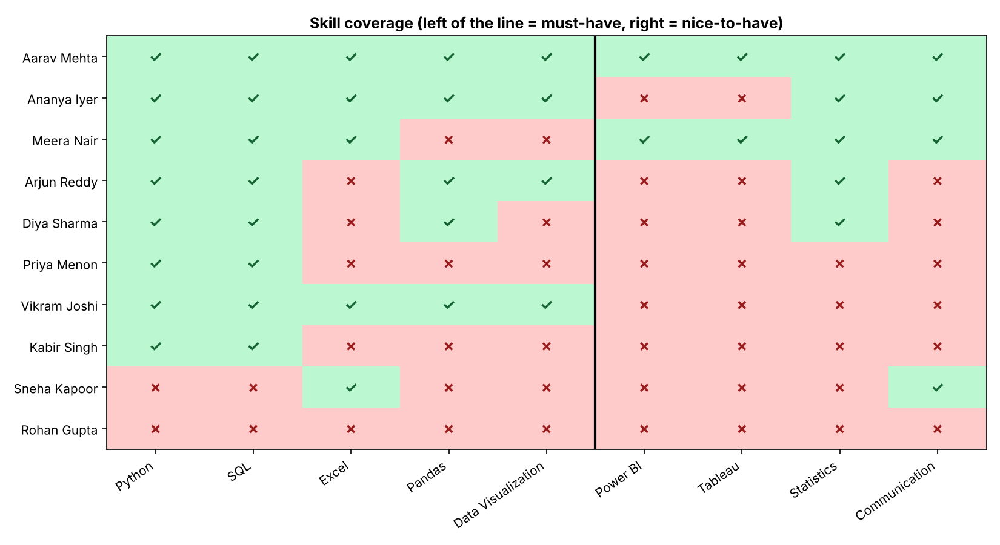
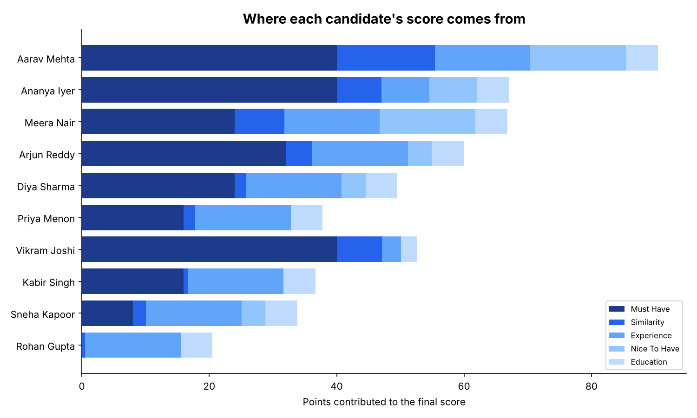

# Automated Resume Screening Tool

An ATS-style resume screener built in Python. It reads resumes in **PDF, DOCX and TXT**, compares them with a
job description using **TF-IDF + cosine similarity** and rule checks, ranks the candidates, and explains every
decision. You can use it from the command line, through an interactive **Streamlit dashboard**, or through a
**FastAPI** REST API.



---

## Problem statement

A single job posting can attract hundreds of applications. Reading each resume by hand is slow and inconsistent,
and it leaves no record of why a candidate was rejected. This tool screens all resumes in seconds against clear,
configurable requirements and produces a ranked shortlist with written reasons for each decision.

## Industry relevance

Applicant Tracking Systems such as Workday, Greenhouse, Lever and Naukri RMS work the same way: they extract text,
detect skills, apply must-have and minimum-experience rules, and rank candidates by relevance. This project covers
text extraction, NLP, feature design, explainable scoring, reporting, dashboards and APIs. Those skills apply to
**Python Developer, Data Analyst, HR-Tech, Automation and NLP/ML** roles.

## Features

- **Multi-format extraction**: PDF (pdfplumber), DOCX including tables (python-docx), TXT
- **Skill detection with aliases**: about 45 skills in 6 categories; `sklearn` → scikit-learn, `PowerBI` → Power BI, `k8s` → Kubernetes
- **Experience calculation**: reads date ranges like `Jun 2022 - Present` and merges overlapping jobs
- **Education detection**: Diploma / Bachelor / Master / PhD
- **Explainable 0–100 score** from five weighted parts (weights adjustable in the dashboard)
- **Three-way decision**: Shortlisted, Review or Rejected, with reasons and warning flags
- **Keyword-stuffing detection**: catches resumes that repeat buzzwords to trick the system
- **Privacy**: emails and phone numbers are removed before scoring
- **Reports**: ranked CSV, shortlist CSV, colour-coded Excel, per-candidate feedback, PNG charts
- **Recruiter dashboard**: KPIs, ranking chart, candidate radar profile, skill-gap heatmap, downloads, custom job descriptions and resume upload
- **REST API**: `POST /screen/{job_id}` with resume files returns the ranked JSON
- **11 automated tests** with pytest

## Tech stack

| Area | Tools |
|---|---|
| Language | Python 3.10+ |
| Text extraction | pdfplumber, python-docx |
| NLP / matching | Regex, scikit-learn (TfidfVectorizer, cosine_similarity) |
| Data | Pandas, NumPy |
| Visualisation | Matplotlib (reports), Plotly (dashboard) |
| Dashboard | Streamlit |
| API | FastAPI, Uvicorn |
| Reports | XlsxWriter (Excel), Rich (terminal tables) |
| Testing | pytest |

## How it works

```
resume upload → text extraction → cleaning → skill extraction → job description matching
             → score calculation → shortlist / review / reject → report generation
```

| Score component | Weight | How it's measured |
|---|---|---|
| Must-have skills | 40% | required skills found ÷ total required |
| Content similarity | 25% | TF-IDF cosine similarity between resume and job description |
| Experience | 15% | candidate years ÷ required years (max 1) |
| Nice-to-have skills | 15% | bonus skills found ÷ total bonus skills |
| Education | 5% | meets the required degree level |

**Shortlisted** = score ≥ 65 and ≥ 80% of must-have skills · **Review** = score ≥ 45 · **Rejected** = below 45.
A keyword-stuffed resume loses 15 points and is never auto-shortlisted.

The full architecture, design decisions and the phase-by-phase build plan are in
[docs/PROJECT_EXPLANATION.md](docs/PROJECT_EXPLANATION.md).

## Folder structure

```
Automated-Resume-Screening-Tool/
├── resumes/                  # 10 sample resumes (PDF, DOCX, TXT)
├── data/
│   ├── skills.json           # skill dictionary with aliases, grouped by category
│   └── job_descriptions/     # data_analyst.json, python_developer.json, ml_engineer.json
├── src/
│   ├── extractor.py          # PDF / DOCX / TXT → text
│   ├── cleaner.py            # PII redaction and text cleaning
│   ├── parser.py             # skills, experience, education, contact details
│   ├── matcher.py            # TF-IDF similarity, scoring formula, decisions
│   ├── screener.py           # full pipeline + results table
│   ├── report.py             # CSV, Excel and feedback reports
│   └── charts.py             # PNG charts
├── outputs/                  # generated reports (committed as examples)
├── images/                   # charts and dashboard screenshots
├── docs/                     # project explanation and interview Q&A
├── scripts/
│   └── create_sample_resumes.py
├── tests/test_screening.py
├── main.py                   # command-line tool
├── app.py                    # Streamlit dashboard
├── api.py                    # FastAPI service
├── requirements.txt
└── .gitignore
```

## Installation

```bash
git clone https://github.com/rohitsingh83/Automated-Resume-Screening-Tool.git
cd Automated-Resume-Screening-Tool
```

Create and activate a virtual environment.

On Windows:

```bash
python -m venv venv
venv\Scripts\activate
```

On macOS or Linux:

```bash
python3 -m venv venv
source venv/bin/activate
```

Install the dependencies:

```bash
pip install -r requirements.txt
```

## How to run

**Command line.** Screens `resumes/` for the Data Analyst job and saves reports to `outputs/`:

```bash
python main.py
```

Pick another job, or point it at your own folder of resumes:

```bash
python main.py --job python_developer
```

```bash
python main.py --job ml_engineer --resumes path/to/resumes
```

**Dashboard.** Opens in the browser at http://localhost:8501:

```bash
streamlit run app.py
```

**REST API.** Interactive docs at http://127.0.0.1:8000/docs:

```bash
uvicorn api:app --reload
```

**Tests:**

```bash
python -m pytest -q
```

**Regenerate the sample resumes:**

```bash
python scripts/create_sample_resumes.py
```

## Sample output

`python main.py` (Data Analyst role):

```text
╭─────────────────── Automated Resume Screening ───────────────────╮
│ Data Analyst at BrightMart Retail Analytics (Bengaluru (Hybrid)) │
│ Must-have: python, sql, excel, pandas, data visualization        │
│ Nice-to-have: power bi, tableau, statistics, communication       │
│ Minimum experience: 1 years                                      │
╰──────────────────────────────────────────────────────────────────╯
 Rank  Candidate     File               Score  Decision     Must-have  Exp   Missing must-have
    1  Aarav Mehta   aarav_mehta.pdf     90.4  Shortlisted       100%  5.4   -
    2  Ananya Iyer   ananya_iyer.pdf     67.0  Shortlisted       100%  0.5   -
    3  Meera Nair    meera_nair.txt      66.8  Review             60%  7.4   pandas, data visualization
    4  Arjun Reddy   arjun_reddy.pdf     60.0  Review             80%  3.9   excel
    5  Diya Sharma   diya_sharma.docx    49.5  Review             60%  6.3   excel, data visualization
    6  Priya Menon   priya_menon.pdf     37.8  Rejected           40%  3.8   excel, pandas, data visualization
    7  Vikram Joshi  vikram_joshi.txt    37.6  Rejected          100%  0.2   -   (flagged: keyword stuffing)
    8  Kabir Singh   kabir_singh.txt     36.7  Rejected           40%  6.5   excel, pandas, data visualization
    9  Sneha Kapoor  sneha_kapoor.docx   33.8  Rejected           20%  4.6   python, sql, pandas, data visualization
   10  Rohan Gupta   rohan_gupta.docx    20.5  Rejected            0%  3.9   python, sql, excel, pandas, data visualization

Shortlisted: 2  Review: 3  Rejected: 5
```

Vikram has every must-have keyword but is rejected: his resume repeats buzzwords with no real experience,
and the stuffing check catches it. The same resumes give a different ranking for other roles. Kabir is
rejected here but ranks **#1 for the Python Backend Developer** job.

Generated reports: [`outputs/data_analyst_screening_report.csv`](outputs/data_analyst_screening_report.csv),
[`outputs/data_analyst_shortlisted.csv`](outputs/data_analyst_shortlisted.csv),
[`outputs/data_analyst_screening_report.xlsx`](outputs/data_analyst_screening_report.xlsx),
[`outputs/data_analyst_candidate_feedback.txt`](outputs/data_analyst_candidate_feedback.txt)
(and the same set for the other two jobs).

## Screenshots

| Candidate profile | Skill gaps |
|---|---|
|  |  |

| Ranking table | Export |
|---|---|
|  |  |

Charts generated by `main.py`:

| Ranking | Skill coverage | Score breakdown |
|---|---|---|
|  |  |  |

## Learning outcomes

- Extracting text from PDF and Word documents, including tables
- Cleaning text with regular expressions without breaking terms like C++ and CI/CD
- Building a skill dictionary with aliases and matching it safely
- Converting text into TF-IDF vectors and comparing them with cosine similarity
- Designing an explainable scoring formula and decision rules
- Detecting attempts to game the system (keyword stuffing)
- Handling fairness and privacy in automated hiring
- Building a multi-tab Streamlit dashboard and a FastAPI service
- Writing unit tests and structuring a project for GitHub

## Interview preparation

15 common interview questions with HR and technical answers, starting with **"Explain your project"**:
[docs/INTERVIEW_QA.md](docs/INTERVIEW_QA.md)

## Disclaimer

All resumes in this repository are fictional and were generated by `scripts/create_sample_resumes.py`.
Automated screening should support recruiters, not replace human judgement.
