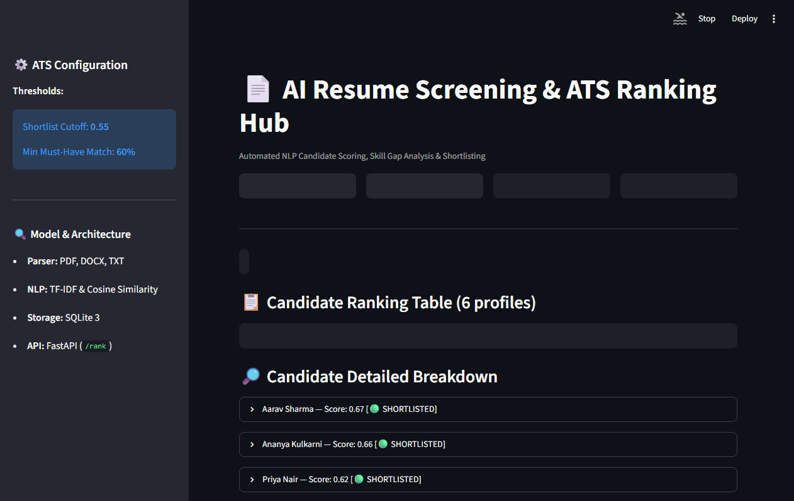
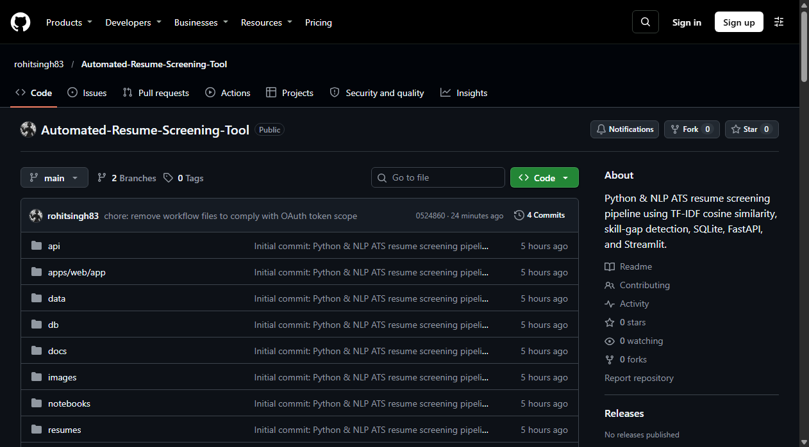

# Automated Resume Screening Tool

A modern NLP and ATS (Applicant Tracking System) screening engine built with Python, scikit-learn, SQLite, and FastAPI. It analyzes candidates across `.docx`, `.pdf`, and `.txt` formats, removes PII to protect privacy, computes TF-IDF semantic relevance against target job descriptions, flags must-have skill deficiencies, and outputs ranked recommendations.

---

## 🏛 Architecture & Processing Pipeline

```
[Resume Files: PDF / DOCX / TXT]
               │
               ▼
   [Text Extraction & Normalization]
               │
               ▼
    [Automated PII Redaction]  (Protects Emails / Phone Numbers)
               │
               ▼
[Skill & Experience Regex Parser]  (Must-have & Good-to-have matching)
               │
               ▼
   [TF-IDF & Cosine Similarity]   (Job Description vs Candidate)
               │
               ▼
    [Multi-Factor ATS Scorer]     (Similarity + Skills + Experience - Penalties)
               │
               ▼
 [SQLite Storage & CSV Reports] + [Interactive Streamlit & FastAPI]
```

---

## ✨ Key Capabilities

- **Multi-Extension Ingestion:** Extracts text cleanly from `.pdf` (via `pypdf`), `.docx` (via `python-docx`), and plain `.txt`.
- **Privacy-Preserving NLP:** Redacts sensitive PII (emails, phone numbers) before passing text to vectorization.
- **Explainable Scoring Engine:** Combines semantic relevance (45%), must-have requirements matching (45%), and experience weighting (10%), offset by missing-skill penalties.
- **Relational Audit Trail:** Records all jobs, candidate profiles, similarity scores, and final decisions into SQLite (`db/screening.db`).
- **RESTful API Service:** Provides `/health` and `/rank` endpoints via FastAPI for microservice integration.
- **Interactive Web Interface:** Streamlit dashboard with real-time candidate score breakdown, status filters, and visual analytics.

---

## 📐 Scoring Formula

The candidate match score is calculated as:

$$\text{Raw Score} = 0.45 \cdot \text{Sim} + 0.45 \cdot \text{MustRatio} + 0.10 \cdot \text{ExpRatio} - 0.05 \cdot N_{\text{missing}}$$

- **Sim:** TF-IDF Cosine similarity between resume and job description.
- **MustRatio:** Proportion of must-have skills satisfied.
- **ExpRatio:** Ratio of candidate experience relative to minimum job requirement.
- **$N_{\text{missing}}$:** Count of critical must-have skills absent.
- **Shortlist Condition:** Candidate score $\ge 0.55$ and $\text{MustRatio} \ge 0.60$.

---

## 🚀 Quick Start Guide

### 1. Environment Setup
```bash
python -m venv venv
# Linux/macOS:
source venv/bin/activate
# Windows:
venv\Scripts\activate

pip install -r requirements.txt
```

### 2. Run Pipeline
```bash
python main.py
```

### 3. Launch Web Dashboard
```bash
python -m streamlit run app_streamlit.py
```

### 4. Start REST API
```bash
uvicorn api.app:app --host 0.0.0.0 --port 8000 --reload
```

### 5. Execute Test Suite
```bash
python -m unittest discover -s tests -v
```

---

## 🔌 API Documentation

| Method | Endpoint | Description |
|---|---|---|
| `GET` | `/health` | Healthcheck and readiness probe. |
| `POST` | `/rank` | Accepts job description, must-have skills, and candidate texts; returns ranked profiles. |

---

## 📊 Sample Visualizations

The pipeline automatically outputs ranking comparison charts into `images/candidate_ranking_chart.png`.

<!-- project-brief-sections -->

---

## 🎯 Problem Statement

Recruiters often receive hundreds of resumes for a single opening. Reading each one by hand is slow, inconsistent, and easy to bias. This tool automatically compares every resume against the job description, checks the must-have skills, and produces a ranked shortlist with a reason for every decision.

## 🏭 Industry Relevance

Applicant Tracking Systems (ATS) such as Workday, Greenhouse and Lever use the same building blocks: text extraction, skill parsing, semantic matching and rule gates (must-have skills, minimum years). This project maps directly to Python Developer, Data Analyst, HR-Tech, Automation and NLP roles.

## 🧰 Tech Stack

- Python 3.10+
- Pandas, NumPy
- pypdf / pdfplumber (PDF), python-docx (DOCX)
- Regex for cleaning, PII redaction and experience extraction
- scikit-learn TF-IDF + cosine similarity
- SQLite (audit trail)
- FastAPI (REST API), Streamlit + Plotly (dashboard)
- Matplotlib (charts), pytest (tests)

## 📁 Folder Structure

```
Automated-Resume-Screening-Tool/
├── api/
│   └── app.py
├── apps/
│   └── web/
│       └── app/
│           └── page.tsx
├── data/
│   ├── job_description.txt
│   ├── labeled_pairs.csv
│   └── skills_config.json
├── db/
│   └── schema.sql
├── docs/
│   ├── GITHUB_GUIDE.md
│   └── INTERVIEW_QA.md
├── images/
├── notebooks/
│   └── 03_eval.py
├── outputs/
│   ├── screening_results.csv
│   └── shortlisted_candidates.csv
├── resumes/
│   ├── aarav_sharma.txt
│   ├── ananya_kulkarni.docx
│   ├── priya_nair.txt
│   ├── rohan_verma.txt
│   ├── sneha_reddy.txt
│   └── vikram_joshi.txt
├── src/
│   ├── __init__.py
│   ├── config.py
│   ├── extract.py
│   ├── features.py
│   ├── ingest.py
│   ├── rank.py
│   └── visualize.py
├── tests/
│   └── test_screening.py
├── .gitignore
├── app_streamlit.py
├── AUDIT.md
├── CHANGELOG.md
├── CONTRIBUTING.md
├── DECISIONS.md
├── Dockerfile
├── main.py
├── MODEL_CARD.md
├── PERF.md
├── PROGRESS.md
├── pyproject.toml
├── README.md
└── requirements.txt
```

## ▶️ How to Run

```bash
pip install -r requirements.txt
python main.py
python -m pytest -q          # run the test suite
streamlit run app_streamlit.py  # interactive dashboard
uvicorn api.app:app --reload   # REST API at http://127.0.0.1:8000/docs
```

## 🧾 Sample Output

Terminal output of `python main.py` (generated from the sample data in `data/`):

```text
=== Automated Resume Screening Tool (sklearn-tfidf) ===
       candidate_name              filename  final_score  must_have_ratio       status                      missing_must_have
rank                                                                                                                         
1        Aarav Sharma      aarav_sharma.txt       0.6701           1.0000  Shortlisted                                   None
2     Ananya Kulkarni  ananya_kulkarni.docx       0.6555           1.0000  Shortlisted                                   None
3          Priya Nair        priya_nair.txt       0.6219           1.0000  Shortlisted                                   None
4         Rohan Verma       rohan_verma.txt       0.4863           0.8333     Rejected                           scikit-learn
5         Sneha Reddy       sneha_reddy.txt       0.1624           0.5000     Rejected            pandas, numpy, scikit-learn
6        Vikram Joshi      vikram_joshi.txt       0.0000           0.1667     Rejected  pandas, numpy, scikit-learn, sql, git

Saved full report to: outputs/screening_results.csv
Shortlisted 3/6 candidates.
```

Generated files (committed in `outputs/` so you can inspect them on GitHub):

- [`outputs/screening_results.csv`](outputs/screening_results.csv): Full ranking: score, similarity, must-have ratio, matched/missing skills, decision and explanation
- [`outputs/shortlisted_candidates.csv`](outputs/shortlisted_candidates.csv): Only the candidates who passed the shortlist rule

## 🖼 Screenshots

### Candidate Ranking Chart


### Dashboard Preview



### Github Repo Preview



## 📚 Learning Outcomes

- Extracting text from PDF, DOCX and TXT files
- Cleaning text with regex and redacting personal data
- Turning text into numbers with TF-IDF and comparing it with cosine similarity
- Designing a transparent, explainable scoring formula
- Storing results in SQLite and exposing them through a FastAPI service
- Building an interactive Streamlit dashboard and writing unit tests

## 🎤 Interview Preparation

10 frequently asked interview questions with answers, including **"Explain your project"**, are in [`docs/INTERVIEW_QA.md`](docs/INTERVIEW_QA.md). GitHub upload steps are in [`docs/GITHUB_GUIDE.md`](docs/GITHUB_GUIDE.md).
