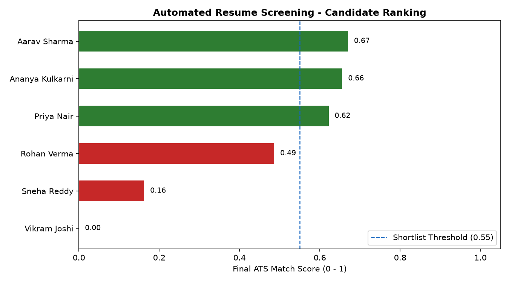

# Automated Resume Screening Tool

An end-to-end Python & NLP system that ingests candidate resumes (`.pdf`, `.docx`, `.txt`), redacts PII, extracts skills and experience, computes TF-IDF cosine similarity against a job description, flags must-have skill gaps, and exports ranked shortlist reports.

## Problem Statement & Industry Relevance
Recruiters receive hundreds of resumes per opening, making manual screening slow and inconsistent. This project simulates an Applicant Tracking System (ATS) scoring pipeline with transparent, skills-first explanations.

## Features
- Multi-format resume ingestion (`.pdf`, `.docx`, `.txt`)
- Automatic PII redaction (emails, phone numbers) before scoring
- Skill, education, and years-of-experience extraction
- TF-IDF + Cosine Similarity matching with must-have skill gap penalties
- SQLite persistence (`db/screening.db`), FastAPI service (`api/app.py`), and Streamlit/Next.js UI
- Exported CSV reports (`outputs/`) and ranking visualization (`images/candidate_ranking_chart.png`)

## Tech Stack
- **Language & Data:** Python 3.11, Pandas, NumPy
- **Parsing:** `python-docx`, `pypdf`, Regex
- **NLP & Scoring:** `scikit-learn` TF-IDF + Cosine Similarity (with NumPy fallback)
- **Backend & UI:** FastAPI, Uvicorn, SQLite, Streamlit, Next.js

## Setup & How to Run
```bash
python -m venv venv
source venv/bin/activate   # Windows: venv\Scripts\activate
pip install -r requirements.txt
python main.py
python notebooks/03_eval.py
python -m unittest discover -s tests -v
```

## Sample Output & Visualization


## Learning Outcomes
- Building modular NLP preprocessing and feature-engineering pipelines
- Designing fair, explainable ranking formulas with gap penalties
- Persisting structured results in SQLite and serving ML pipelines via FastAPI
